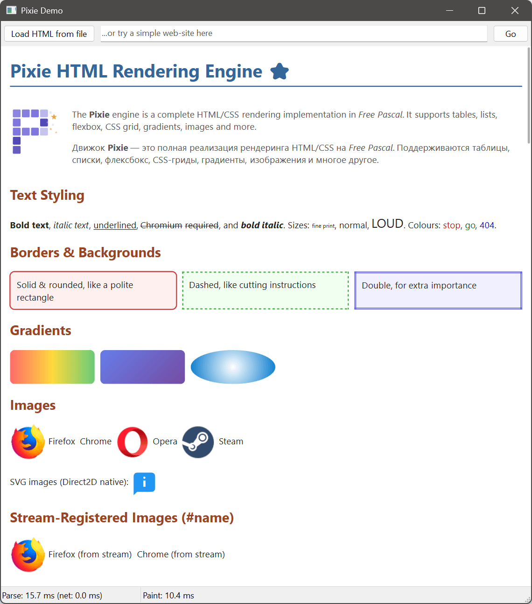
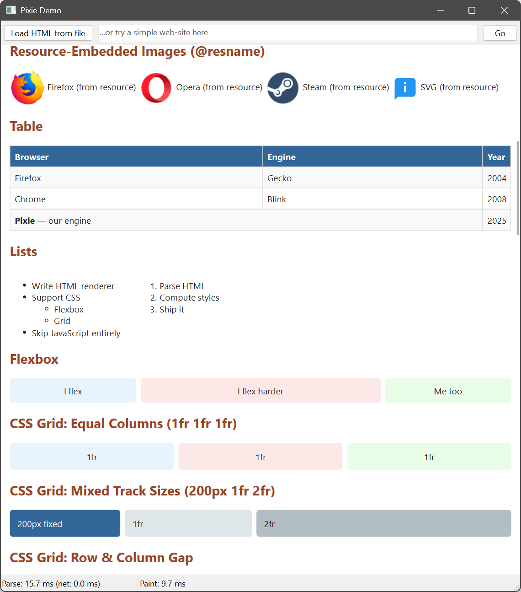
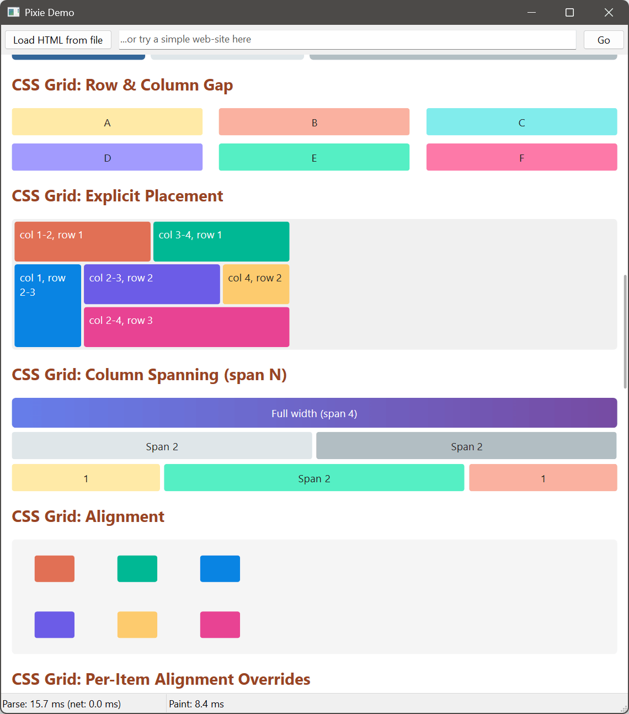
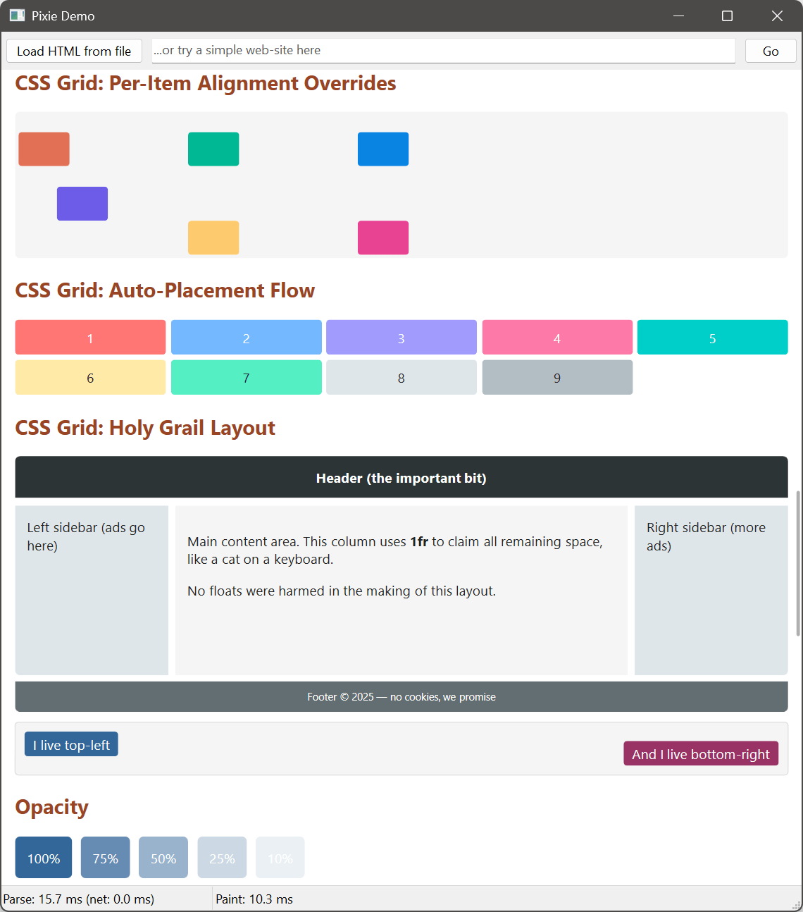
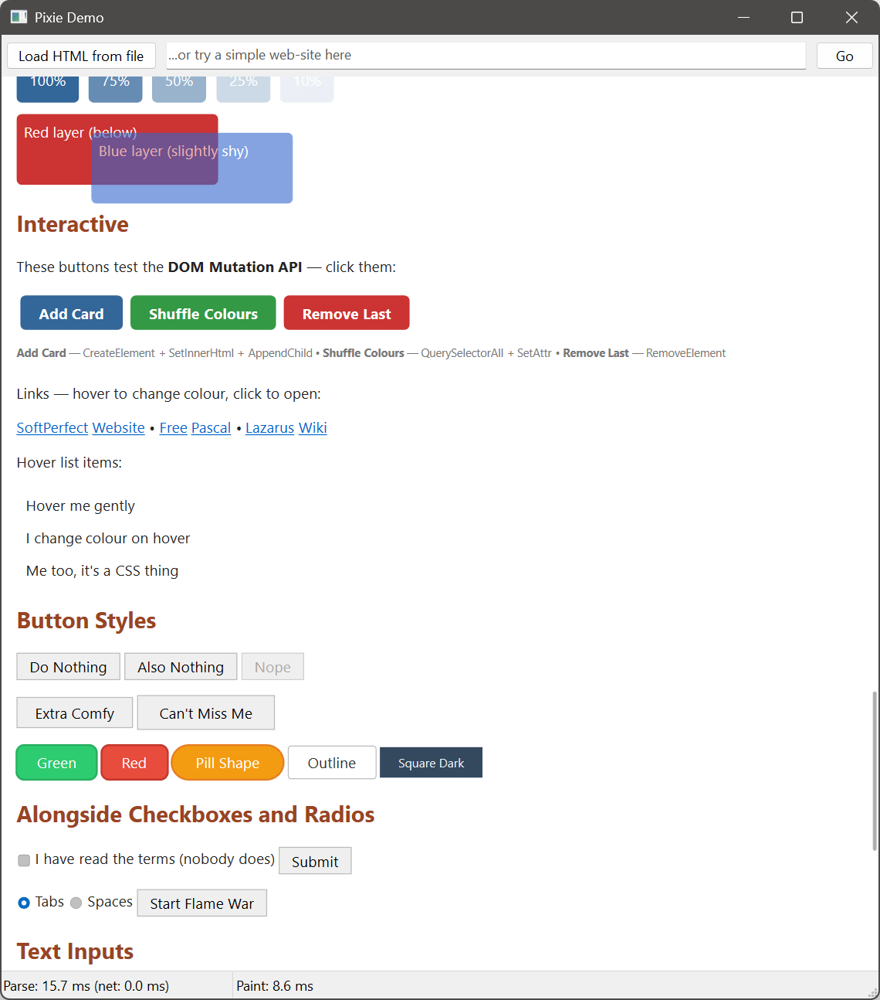
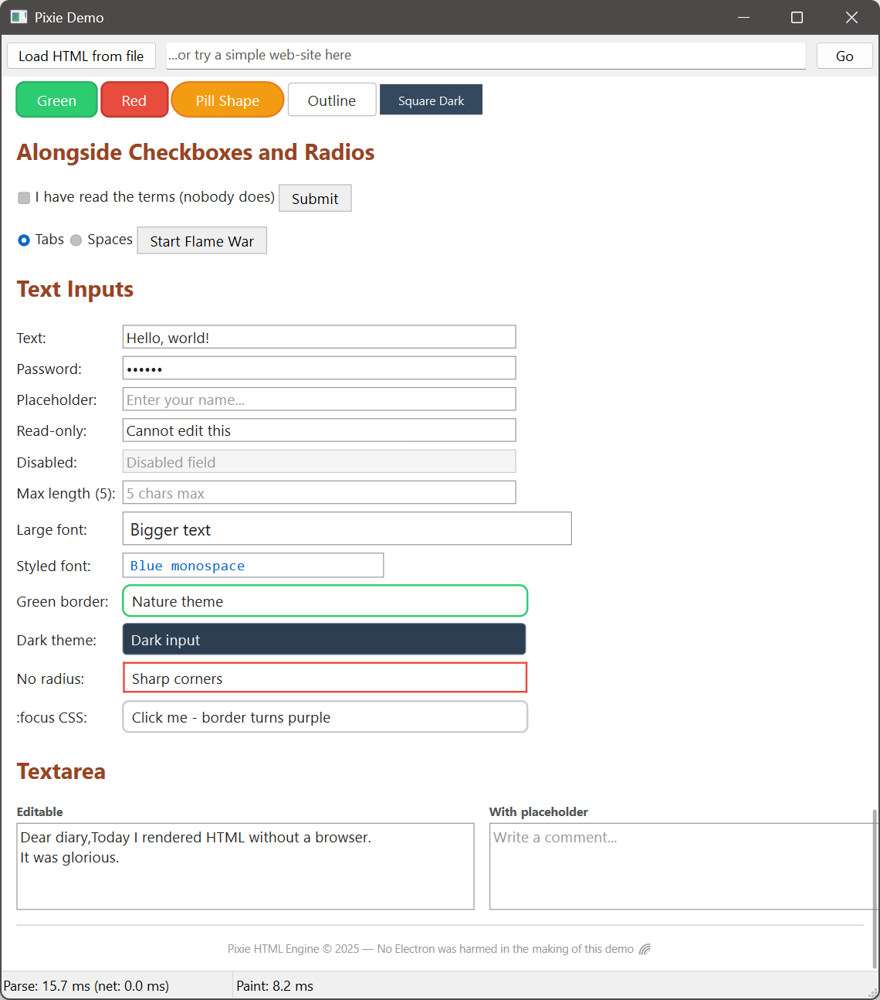

<p align="center">
  
</p>

<p align="center">
  A lightweight HTML/CSS rendering engine for Free Pascal and Lazarus.
</p>

<p align="center">
  <a href="#features">Features</a> &middot;
  <a href="#screenshots">Screenshots</a> &middot;
  <a href="#getting-started">Getting Started</a> &middot;
  <a href="#usage">Usage</a> &middot;
  <a href="#download">Download</a> &middot;
  <a href="#licence">Licence</a>
</p>

---

Pixie is a drop-in Lazarus component (`TPixieHtmlView`) that renders HTML and CSS using platform-native graphics. No browser engine, no embedded Chromium, no external dependencies &mdash; just a single package you add to your project.

It ships with three rendering backends so the same code works across operating systems:

| Platform | 2D Drawing | Text | Images |
|----------|-----------|------|--------|
| Windows | Direct2D | DirectWrite | WIC |
| Linux | Cairo | Pango | FPImage + librsvg |
| macOS | Core Graphics | Core Text | ImageIO |

## Features

**HTML**
- Full HTML5 tokeniser (68 states) and tree builder (23 insertion modes)
- 2125 named character entities
- Automatic tag closing, implicit elements, adoption agency algorithm, foster parenting
- SVG and MathML foreign content

**CSS**
- CSS3 tokeniser and parser (W3C CSS Syntax Level 3)
- Full cascade with specificity calculation
- Selectors: type, class, ID, attribute, combinators, `:nth-child()`, `:not()`, `:is()`, `:hover`, `:active`, `:focus`, `:checked`, `::before`/`::after`
- Box model, floats, positioning (static, relative, absolute, fixed)
- Flexbox and CSS Grid layout
- Gradients: `linear-gradient()`, `radial-gradient()`, `conic-gradient()` with repeating variants
- `@media` queries (Level 4 range syntax)
- Custom properties with `var()` support
- Built-in user-agent stylesheet (110 selectors)

**Layout**
- Block and inline formatting contexts with margin collapsing
- Table layout with `colspan`/`rowspan`
- Flexbox (row/column, wrap, grow/shrink, alignment)
- CSS Grid (explicit tracks, `fr` units, placement, spanning, auto-placement)
- Float positioning and clearing

**Interaction**
- Mouse hover, click, `:hover`/`:active` pseudo-class repainting, CSS cursors
- Text selection with mouse drag, double-click word select, Ctrl+C copy
- Owner-drawn form controls: text input, password, textarea, checkbox, radio, button
- Caret, selection, clipboard, undo, Tab/Shift+Tab focus cycling

**DOM API**
- `CreateElement`, `CreateTextNode`, `AppendChild`, `RemoveElement`
- `GetElementById`, `QuerySelector`, `QuerySelectorAll`
- `SetInnerHtml`, `SetElementText`, `SetAttr`, `AddStylesheet`
- Live DOM mutation with automatic re-render (`BeginUpdate`/`EndUpdate` for batching)

## Screenshots

<p align="center">
  
  
  
  
  
  
</p>

## Getting Started

**Requirements:** [Lazarus](https://www.lazarus-ide.org/) with Free Pascal.

1. Open `package/Pixie.Package.lpk` in the Lazarus IDE.
2. Click **Compile**, then **Use > Install**.
3. Restart the IDE. `TPixieHtmlView` appears on the component palette.

Or add the package as a dependency without installing:

1. Open your project's `.lpi` in the IDE.
2. Go to **Project > Project Inspector > Add > New Requirement**.
3. Select `Pixie.Package`.

## Usage

Drop a `TPixieHtmlView` on a form:

```pascal
procedure TForm1.FormCreate(Sender: TObject);
begin
  PixieHtmlView1.LoadHtml(
    '<h1>Hello, Pixie!</h1>' +
    '<p style="color: steelblue;">Rendering HTML in Pascal.</p>');
end;
```

Load from a file:

```pascal
PixieHtmlView1.BaseUrl := 'file://' + ExtractFilePath(ParamStr(0));
PixieHtmlView1.Html.LoadFromFile('page.html');
```

Handle link clicks:

```pascal
procedure TForm1.PixieHtmlView1AnchorClick(Sender: TObject; const Url: string);
begin
  OpenURL(Url);
end;
```

Mutate the DOM at runtime:

```pascal
var
  Doc: TPixieDocument;
  El: TPixieElement;
begin
  Doc := PixieHtmlView1.Document;
  Doc.BeginUpdate;
  try
    El := Doc.CreateElement('div', nil);
    Doc.SetInnerHtml(El, '<strong>Added dynamically</strong>');
    Doc.Root.AppendChild(El);
  finally
    Doc.EndUpdate;
  end;
end;
```

## Download

Pre-built demo application for Windows:

[**Download latest release**](https://gitlab.com/api/v4/projects/retrofoxed%2Fpixie/packages/generic/pixie-demo/1.0.0/PixieDemo-win64.zip)

## Licence

[MIT](LICENSE) &copy; [SoftPerfect Pty Ltd](https://www.softperfect.com)
